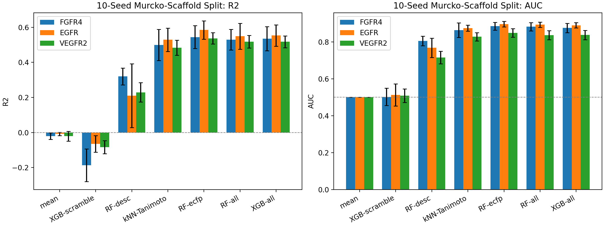
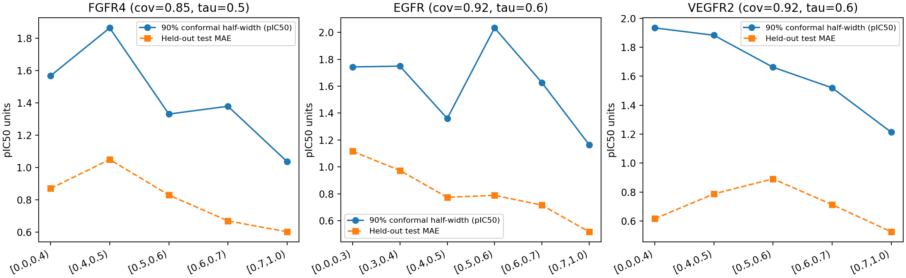
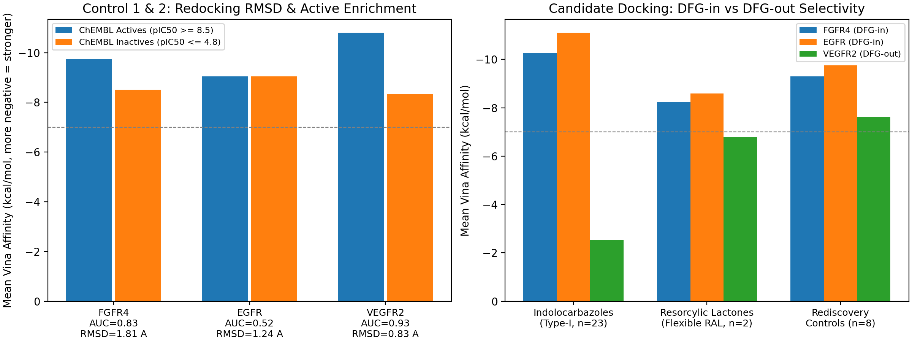

# Domain-Calibrated ML & Structure-Based Virtual Screening of Natural Products Against HCC Kinases (`EGFR`, `FGFR4`, `VEGFR2`)

Reproducible end-to-end virtual screening pipeline combining **10-seed generic Murcko-scaffold QSAR**, **Mondrian split-conformal applicability domain (AD) calibration**, **full-library natural product screening (738,827 COCONUT compounds)**, and **orthogonal 3D molecular docking validation (AutoDock Vina 1.2.5)** against three Hepatocellular Carcinoma (HCC) receptor tyrosine kinases: **EGFR** (`1M17`), **FGFR4** (`5JKG`), and **VEGFR2** (`4ASD`).

---

## Repository Structure

```text
├── data/
│   ├── ligands_chembl/          # Curated human binding IC50 datasets (EGFR, FGFR4, VEGFR2)
│   ├── ligands_phytochemical/   # Full COCONUT natural products library (see data/README.md)
│   ├── targets/                 # Co-crystal PDB & prepared PDBQT receptors (1M17, 5JKG, 4ASD)
│   └── features/                # Engineered 21 physchem descriptors + 2,048-bit ECFP4 tables
├── models/
│   ├── <TARGET>_xgb_final.json  # Final scaffold-trained XGBoost regressors
│   └── <TARGET>_conformal.json  # Mondrian split-conformal 90% calibration & AD thresholds (tau)
├── results/
│   ├── figures/                 # Publication figures (fig1_benchmark, fig2_domain_shift, fig3_docking)
│   ├── metrics/                 # Benchmark, conformal calibration, screening & docking JSON/CSV metrics
│   ├── predictions/             # Consensus hits, PAINS/QED annotations & Vina docked affinities
│   ├── docking_poses/           # 3D docked PDBQT poses (redocking controls, enrichment, candidates)
│   └── reports/                 # Auto-generated markdown report (results_report.md)
├── scripts/
│   ├── common.py                # Shared Murcko-scaffold split, ECFP4, Tanimoto-kNN, NP-likeness
│   ├── 01_fetch_chembl_data.py  # Curated ChEMBL IC50 bioactivity downloader
│   ├── 02_feature_engineering.py# 21 RDKit physicochemical descriptors + 2,048-bit ECFP4
│   ├── 03_scaffold_benchmark.py # 10-seed Murcko-scaffold benchmark + Y-scramble & kNN controls
│   ├── 04_conformal_ad_models.py# Mondrian conformal calibration & synthetic->NP domain-shift analysis
│   ├── 05_screen_coconut_library.py # Parallel streaming screen of 738,827 COCONUT compounds
│   ├── 06_docking_validation.py # AutoDock Vina 1.2.5 redocking, active enrichment & candidate docking
│   ├── 07_generate_report.py    # Automated report & figure generator
│   └── run_pipeline.py          # Master checkpointed pipeline orchestrator (Steps 1–7)
├── COMMANDBOOK.md               # Quick CLI execution reference
└── requirements.txt             # Verified Python package versions
```

---

## Quick Start

```bash
git clone https://github.com/thinkiamparanoid2/hcc-kinase-conformal-screen.git
cd hcc-kinase-conformal-screen
pip install -r requirements.txt

# Run full 7-step pipeline (with automatic checkpoint/resume)
python scripts/run_pipeline.py
```

---

## Key Results Summary

### 1. 10-Seed Generic Murcko-Scaffold Benchmark (`scripts/03_scaffold_benchmark.py`)

Mean $\pm$ SD across 10 independent 80/20 generic Murcko-scaffold splits (`active` defined as $\text{pIC}_{50} \ge 6.0$):

| Target | $n$ | `XGB-scramble` ($R^2$ / AUC) | `kNN-Tanimoto` ($R^2$) | `RF-ecfp` ($R^2$ / AUC) | `XGB-all` ($R^2$ / AUC) | `XGB-all` vs `kNN` Wilcoxon $p$ |
|:---|---:|:---:|:---:|:---:|:---:|:---:|
| **FGFR4** | 3,682 | `-0.187` / `0.502` | `0.499 +/- 0.068` | **`0.544 +/- 0.065`** / `0.903` | `0.535 +/- 0.067` / `0.892` | `0.0039` (9/10 wins) |
| **EGFR** | 9,844 | `-0.065` / `0.508` | `0.529 +/- 0.056` | **`0.585 +/- 0.052`** / `0.899` | `0.553 +/- 0.053` / `0.889` | `0.0371` (8/10 wins) |
| **VEGFR2** | 9,247 | `-0.083` / `0.513` | `0.483 +/- 0.036` | **`0.537 +/- 0.032`** / `0.840` | `0.518 +/- 0.030` / `0.831` | `0.0098` (9/10 wins) |



### 2. Mondrian Conformal Calibration & Synthetic $\to$ Natural-Product Domain Shift (`scripts/04_conformal_ad_models.py`)

- **Empirical 90% coverage on held-out scaffold test sets:** `0.849` (FGFR4, $\tau = 0.50$), `0.918` (EGFR, $\tau = 0.60$), `0.921` (VEGFR2, $\tau = 0.60$).
- **Synthetic $\to$ NP domain shift:** Held-out test $R^2$ drops from `0.467 -> 0.071` (FGFR4), `0.580 -> -0.229` (EGFR), and `0.474 -> -0.107` (VEGFR2) on NP-like test molecules ($\text{NP-likeness} \ge 0$), proving why uncalibrated screening without similarity-binned conformal intervals produces false-positive rankings.



### 3. Orthogonal 3D Structure-Based Validation (`scripts/06_docking_validation.py`)

- **Control 1 (Co-Crystal Redocking):** Best-of-9 RMSD = **`0.83 Å`** for VEGFR2 (`4ASD` Sorafenib, top-1 = `0.83 Å` at `-12.25 kcal/mol`), **`1.24 Å`** for EGFR (`1M17` Erlotinib), and **`1.81 Å`** for FGFR4 (`5JKG` `6LF`).
- **Control 2 (ChEMBL Active vs. Inactive Enrichment):** Strong active enrichment in **VEGFR2 (`4ASD`, ROC-AUC = `0.931`, $p = 0.0002$)** and **FGFR4 (`5JKG`, ROC-AUC = `0.826`, $p = 0.0036$)**; no separation by rigid-receptor Vina alone in open-cleft **EGFR (`1M17`, ROC-AUC = `0.521`)**.
- **Candidate Docking & Conformational Selectivity (`DFG-in` vs. `DFG-out`):**
  - Rigid hexacyclic **indolocarbazole glycosides** (`K252a-Me`, `O-demethyl-N-demethyl-staurosporine`, `Staurosporine M1`) bind strongly to **DFG-in** FGFR4 (`-9.67` to `-11.70 kcal/mol`) and EGFR (`-10.67` to `-11.66 kcal/mol`), but sterically clash with the **DFG-out (Type-II)** pocket of VEGFR2 `4ASD` (`-0.54` to `-4.90 kcal/mol`).
  - Flexible macrocyclic **resorcylic acid lactones (RALs)** — **`15-O-desmethyl-(5Z)-7-oxozeaenol` (`CNP0277321.1`, NP-likeness = `2.28`, QED = `0.52`, PAINS = `False`)** and **`CNP0143079.3` (NP-likeness = `2.37`, QED = `0.49`, PAINS = `False`)** — dock favorably across **all three** pockets (`-8.44, -8.93, -7.11 kcal/mol` for `CNP0277321.1`).



---

## Full Report

See [`results/reports/results_report.md`](results/reports/results_report.md) for the complete auto-generated tables and [`results/predictions/consensus_hits_docked.csv`](results/predictions/consensus_hits_docked.csv) for the docked candidate shortlist.
